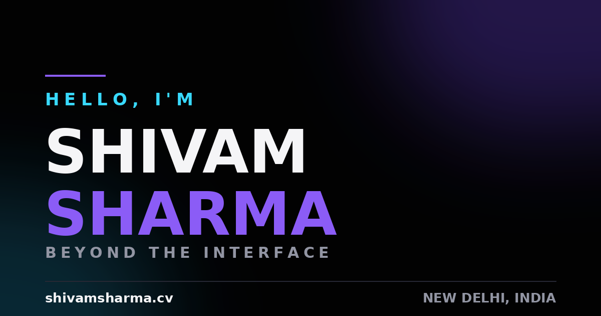

# 🌟 Shivam Sharma — Personal Portfolio & Creative Lab

<p align="center">
  <a href="https://shivamsharma.cv/">
    
  </a>
</p>

<p align="center">
  <strong>Beyond the Interface: Computer Science Undergraduate, Software Developer & AI Explorer</strong>
</p>

<p align="center">
  <a href="https://shivamsharma.cv/"></a>
  <a href="https://github.com/sharmashivam102006-arch"></a>
  <a href="https://www.linkedin.com/in/shivam102006"></a>
  <a href="https://leetcode.com/u/ShivamSharma10"></a>
</p>

---

## 🌐 Live Website

> **Production Deployment:** [https://shivamsharma.cv/](https://shivamsharma.cv/)

A bespoke, dark-themed, ultra-smooth portfolio engineered from scratch. It highlights production projects, full-stack architectures, AI experiments, interactive tools, and engineering milestones.

---

## ✨ Features & Architecture

- **⚡ Zero Bloat, Instant Load**: Built with clean, semantic HTML5, modern vanilla CSS3 design tokens, and optimized JavaScript. No heavyweight dependencies or complex build steps required.
- **🎨 Bespoke Design & Micro-Interactions**:
  - Precision custom magnetic cursor and ambient canvas effects.
  - Interactive **ChromaGrab** color laboratory with native `EyeDropper` API simulation and real-time color conversions (HEX, RGB, HSL).
  - Terminal-inspired chatbot & Q&A assistant simulator (**"Ask the Machine"**) answering queries about background, stack, and philosophy.
  - Expandable, detailed **Case Studies** for flagship full-stack systems.
- **📱 Fully Responsive & Accessible**: Fluid typography (`clamp()`), WCAG compliant contrast ratios, skip links, and touch-friendly mobile layouts.
- **🔍 SEO & Social Ready**: Full OpenGraph tags, Twitter Cards, JSON-LD structured schema (`Person`), and custom SVG favicons.

---

## 🛠️ Tech Stack & Showcase

### Portfolio Core
| Technology | Role |
| :--- | :--- |
| **HTML5 & Vanilla JavaScript** | Semantic structure, event orchestration, interactive labs |
| **Modern CSS3 (Custom Properties)** | Theme tokens, dark atmosphere, responsive grids, micro-animations |
| **Typography & Assets** | *Space Grotesk*, *Inter*, and *JetBrains Mono* |

### Flagship Projects Featured
- 🍽️ **[Tavessa](https://github.com/sharmashivam102006-arch/tavessa)** ([Live Demo](https://tavessa.vercel.app/)): Multi-tenant Restaurant Operating System unifying Guest QR ordering, Kitchen Display Systems (KDS), Staff point-of-service, and Owner analytics on a synchronized FastAPI + PostgreSQL backend.
- 🤟 **[SignSpeak Telecom](https://github.com/sharmashivam102006-arch/signspeak-telecom)**: Accessible bidirectional telecommunication platform connecting Deaf / hard-of-hearing and hearing participants via real-time computer vision sign recognition, TTS, and live audio captioning (Next.js, FastAPI, MediaPipe, Whisper, Piper TTS, LiveKit).
- 🎨 **ChromaGrab**: Chrome Extension (Manifest V3) for zero-latency, high-precision eyedropping and multi-format palette saving.
- 🧠 **[Mental Health Predictor](https://github.com/sharmashivam102006-arch/Mental-Health-Predictor)**: Machine learning ensemble investigating student lifestyle factors with interactive "What-If" scenario simulations.
- 🎬 **[MovieVerse](https://github.com/sharmashivam102006-arch/movie-recommendation-system)**: Content-based recommendation engine powered by TF-IDF vectorization, cosine similarity, and TMDB API integrations.

---

## 📂 Repository Structure

```text
.
├── assets/
│   └── og-image.png       # OpenGraph preview asset for social sharing & cards
├── index.html             # Main portfolio experience, interactive labs & styles
├── CNAME                  # Custom domain configuration (shivamsharma.cv)
├── .gitignore             # Standard git exclusions
└── README.md              # Project documentation
```

---

## 🚀 Running Locally

Because this project is built cleanly with pure web standards, you can run it without any package installations:

1. **Clone the repository:**
   ```bash
   git clone https://github.com/sharmashivam102006-arch/portfolio.git
   cd portfolio
   ```

2. **Serve locally:**
   You can open `index.html` directly in any web browser, or serve it using your preferred local server:

   ```bash
   # Using Python 3
   python -m http.server 3000

   # Or using Node.js npx
   npx serve .
   ```

3. **Visit in your browser:**
   ```
   http://localhost:3000
   ```

---

## 📬 Contact & Socials

- 🌐 **Portfolio**: [shivamsharma.cv](https://shivamsharma.cv/)
- 💼 **LinkedIn**: [linkedin.com/in/shivam102006](https://www.linkedin.com/in/shivam102006)
- 🐙 **GitHub**: [@sharmashivam102006-arch](https://github.com/sharmashivam102006-arch)
- ⚡ **LeetCode**: [ShivamSharma10](https://leetcode.com/u/ShivamSharma10)
- 📧 **Email**: [sharmashivam102006@gmail.com](mailto:sharmashivam102006@gmail.com)

---

<p align="center">
  Designed & Built with precision by <strong>Shivam Sharma</strong> • © 2026 All Rights Reserved
</p>
